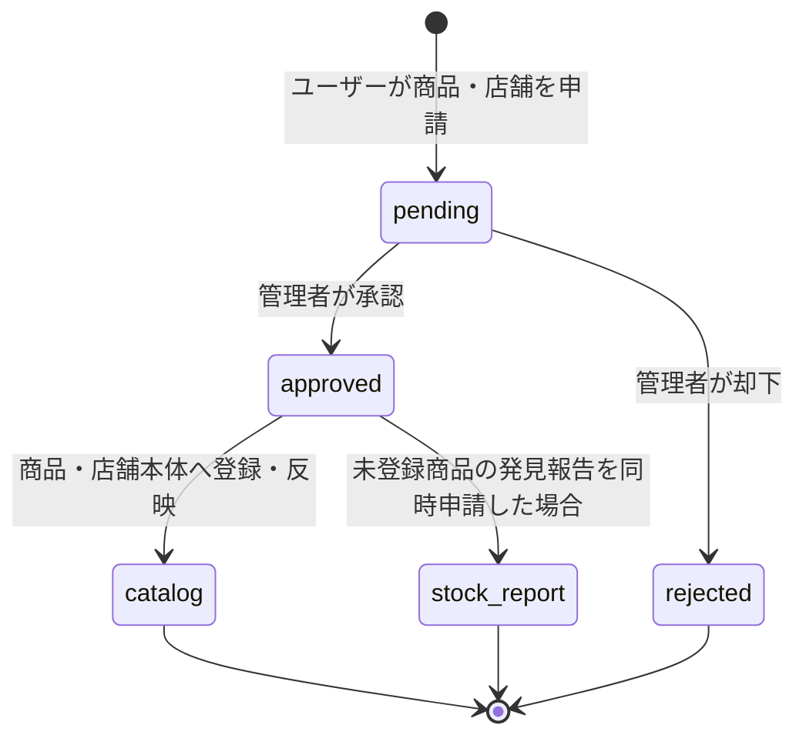

# CosFind データフロー図

最終確認日: 2026-10-06

この図は、Web/PWA/Capacitorアプリから送られたデータが、Cloudflare Workers上のNext.js APIを経由してSupabaseへ保存され、公開画面へ戻るまでの流れを示します。

```mermaid
flowchart LR
  subgraph ACTOR[利用者]
    Guest[未ログイン利用者]
    User[ログイン利用者]
    Admin[管理者]
  end

  subgraph CLIENT[共通フロントエンド]
    Web[Web / PWA]
    Mobile[Android / iOS\nCapacitor]
    UI[Next.js UI\n地図・検索・詳細・フォーム]
  end

  subgraph CF[Cloudflare Workers / OpenNext]
    Pages[公開ページ・Server Loader]
    AuthAPI[/api/auth/*]
    CommunityAPI[/api/community/*]
    AdminAPI[/api/admin/*]
    MobileAPI[/api/mobile/pages]
    Guard[Cookie認証・管理者確認\n入力検証・Rate Limit]
  end

  subgraph SB[Supabase]
    Auth[(Auth\nメール・パスワード・user_metadata)]
    Profiles[(profiles\n状態・管理者・投稿停止)]
    Catalog[(brands / products\nproduct_variants)]
    Stores[(store_chains / stores)]
    Reports[(stock_reports)]
    Requests[(product_requests / store_requests)]
    Metadata[(store_requests\nstatus = metadata\n営業時間・駅・路線・取扱ブランド)]
    News[(announcements)]
    View[(public_stock_summaries)]
    Storage[(Storage\navatars / railway-line-images)]
  end

  subgraph EXTERNAL[外部サービス]
    Map[OpenStreetMap系タイル\nMapLibre表示]
    X[X @CosFindApp]
  end

  Guest --> Web
  User --> Web
  User --> Mobile
  Admin --> Web
  Web --> UI
  Mobile --> UI

  UI -->|公開データ閲覧| Pages
  UI -->|モバイル用ページ取得| MobileAPI
  Pages --> Catalog
  Pages --> Stores
  Pages --> View
  Pages --> Metadata
  Pages --> News
  UI --> Map

  UI -->|登録・ログイン・プロフィール・お気に入り| AuthAPI
  AuthAPI --> Guard
  Guard --> Auth
  Auth -->|新規登録時に連携| Profiles
  AuthAPI --> Profiles
  AuthAPI -->|お気に入りID| Auth
  AuthAPI -->|アイコン画像| Storage

  UI -->|在庫報告・商品申請・店舗申請| CommunityAPI
  CommunityAPI --> Guard
  CommunityAPI -->|在庫あり| Reports
  CommunityAPI -->|審査待ち pending| Requests
  CommunityAPI -->|取扱ブランド報告| Metadata

  UI -->|管理・承認・編集・削除| AdminAPI
  AdminAPI --> Guard
  AdminAPI --> Catalog
  AdminAPI --> Stores
  AdminAPI -->|申請を承認 / 却下| Requests
  AdminAPI --> Metadata
  AdminAPI --> News
  AdminAPI --> Storage
  AdminAPI -.お知らせ同時投稿.-> X

  Reports --> View
  Catalog --> View
  Stores --> View
  View -->|投稿者user_idを除外した集計| Pages
```

## 申請データの状態遷移



## 現在の保存場所

- 商品本体: `brands`、`products`、`product_variants`
- 店舗本体: `store_chains`、`stores`
- 在庫あり報告: `stock_reports`（内部では必ず `user_id` を保持）
- 商品・店舗申請: `product_requests`、`store_requests`（`pending / approved / rejected`）
- 店舗営業時間、駅名、路線、鉄道会社、仮取扱ブランド: `store_requests` の `status = metadata`
- ログイン情報とパスワード: Supabase Auth（パスワード本文はCosFindのテーブルへ保存しない）
- 公開プロフィール管理: `profiles`
- お気に入り商品・店舗ID: Supabase Authの `user_metadata`
- プロフィール画像・路線記号画像: Supabase Storage
- お知らせ: `announcements`
- ポイント: 専用残高テーブルではなく、対象となる報告・申請件数から都度計算

## 公開時の境界

- ブラウザにはPublishable keyのみを渡し、Secret keyはCloudflare Workers内だけで使用します。
- 公開画面へ返す在庫集計には投稿者の `user_id` を含めません。
- 投稿・申請・管理操作はAPI側でCookie認証、権限、入力値、回数制限を確認します。
- Supabase未設定の開発環境では、カタログ閲覧をモックリポジトリへ切り替えられます。
